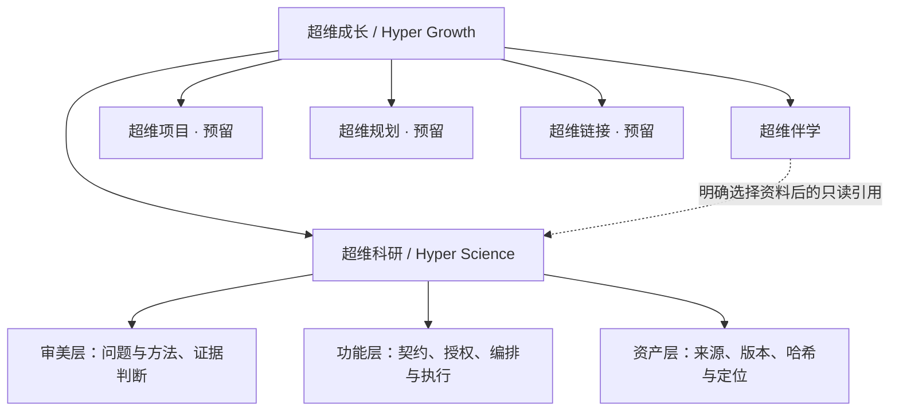

# 超维科研 · Hyper Science

[English](README.en.md) · [使用说明](docs/USER-GUIDE.zh-CN.md) · [开发续接](docs/DEVELOPMENT.md) · [贡献](CONTRIBUTING.md) · [许可范围](LICENSES.zh-CN.md)

面向真实问题的研究工作台：把问题转成可检查的计划，整理资料与证据，设计实验，运行有边界的模拟，再形成可追溯的成果和修订。适用于科学、人文、社会、设计及生活问题。

这是科研工作流 v0.2 的公开源码快照。保留运行所需的共享 BASE、身份、伴学适配和网页/MCP代码；科研模块本身保持独立。共享宿主沿用既有内部名称与版本，Python发行包名称为 `hyper-science`。

## 在超维成长中的位置



科研与伴学平行，项目和学科数据独立组织；父级统一接入和其余三个板块仍是架构预留。三层职责见 [架构说明](docs/ARCHITECTURE.md)。审美层指专业判断和研究标准。

## 已实现的流程

- 项目、问题卡、观察记录，按研究方法选择方向和计划。
- UTF-8文字与含文字PDF原件导入、项目内检索、版本与原文位置核对。
- 主动查询Crossref、OpenAlex、arXiv，保留查询范围和来源。
- 实验设计：研究单位、独立重复、随机化、控制、反例；生成随机分配、两水平全因子、拉丁超立方表。
- 固定的有界SimPy排队模型，独立重复、参数来源和区间；任务可取消、重试。
- 主张关联依据、简报版本、反馈、Markdown与JSON导出；模型服务可选，使用用户自己的配置。

当前模拟只覆盖排队过程。材料组织、力学性能、有限元等模型需要另接专用执行器。引用完整性检查不等于证据语义或领域结论已经审定。

## Windows源码启动

需要Python环境管理工具 `uv`，主程序Python3.11、科研执行环境Python3.12。锁文件按Windows环境保存，其他系统尚未在本次发布中验证。

```powershell
git clone https://github.com/MkaliezZ/hyper-science.git
cd hyper-science
powershell -ExecutionPolicy Bypass -File scripts/setup_science.ps1
powershell -ExecutionPolicy Bypass -File scripts/start_science.ps1
```

首次在主入口建立本人身份，再点击“超维科研”。启动脚本使用本仓库的 `data/science`，适合全新的独立实例。不要把现有数据直接搬进来；已有实例的联动与备份见[使用说明](docs/USER-GUIDE.zh-CN.md)。基本手工流程无需模型密钥。

## 开源Skill接入

固定上游 `K-Dense-AI/scientific-agent-skills` commit `5f2bc0341354fd5590aef76a533ada1e1e5b4e62`。选取10项：scientific-brainstorming、scientific-critical-thinking、hypothesis-generation、literature-review、paper-lookup、citation-management、liteparse、scientific-writing、experimental-design、simpy。

它们分别提供规则参考、程序底稿或辅助函数，实际范围见[工作流与Skill对应](docs/research-workflow-v02.md)。仓库包含固定版本的选定文档和未修改脚本子集、逐文件哈希及MIT/Apache许可。没有安装全部上游Skill。Skills在功能层内部适配，不取代三层架构。

## 材料学示例与验证

[6061铝合金示例](examples/materials-6061/README.md)提供资料卡、12条合成硬度数据和填写参考，演示四组合实验计划。数据不是实测，因素水平不是工艺建议。此前的视频录制未完成，本仓库不包含录制视频。

本次公开源码的实际检查范围记录在[发布核验](docs/VALIDATION.md)。模型实连、专业审定、真实实验校准及学习效果不由工程测试代替。个人项目、账号、密钥、数据库、运行截图和旧安装包均不在发布范围内，见[发布清单](PUBLICATION.json)。

## 开发与许可

保留 `LocalRuntime.invoke_capability` 统一入口和v1/v2契约；进入开发前阅读 [AGENTS.md](AGENTS.md)、[开发说明](docs/DEVELOPMENT.md)与[贡献约定](CONTRIBUTING.md)。

本项目原创源码沿用 [MIT](LICENSE)，第三方内容按原许可保留，详见[中文](LICENSES.zh-CN.md) / [English](LICENSES.md)。
