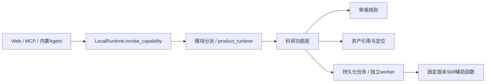

# 三层架构 / Three-layer architecture

超维成长是未来统一入口，平行接入伴学、科研、项目、规划、链接。科研并非伴学子菜单或学科库，后三个模块当前只有预留描述。公开源码为保持可运行，保留当前共享宿主。

| 层 / Layer | 决策与责任 / Responsibility | 路径 / Location |
|---|---|---|
| 审美 / Aesthetic | 判断问题、方法、反例、主张和证据关系；research judgement, no I/O | src/base/app/research/aesthetic |
| 功能 / Functional | 契约、项目授权、持久化、编排、模型和工具执行；authorization and execution | src/base/app/research/functional |
| 资产 / Assets | 引用、版本、SHA256、页/字符定位、确定性文字检索；provenance and integrity | src/base/app/research/assets |

功能层可依赖前两层。审美层不导入数据库、网络、功能层、Runtime或模型SDK；资产层不依赖审美层、功能层或Runtime。存取原件与数据库的授权和事务由功能层执行，资产层负责引用规则。

`research.capability.v1`保留基础项目、问题卡、记录和联动；v2增加资料、任务、实验、模拟及成果。Schema在docs/contracts。传输层不能复制授权和证据逻辑。

科研项目按项目组织，伴学按学科隔离。一个本机实例内可共享身份与模型配置，但配对不自动授予科研项目权限。联动仅限显式选择的本人伴学文字资产，每次读取核对当前授权、来源版本和哈希；不改变伴学当前学科。独立新实例不会自动看到另一个实例的伴学资料。

Skills是内部实现。审美层提炼可检查的研究原则，功能层包装辅助脚本，资产层保存来源版本。研究方法审定、引文语义支持和模型现实校准均不能由执行成功替代。

English: Hyper Growth will unify five parallel modules. Functional code orchestrates pure aesthetic judgement and asset-reference rules through one Runtime facade. Research projects remain independent of companion subject stores. Links are explicit, read-only, authorized and version-bound. Skill helpers implement bounded capabilities without becoming a new architecture layer.
